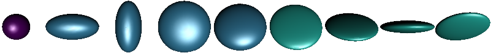

# [Symmetric positive definite matrices](@id SymmetricPositiveDefiniteSection)

```@docs
SymmetricPositiveDefinite
```

This manifold can -- for example -- be illustrated as ellipsoids:  since the eigenvalues are all positive they can be taken as lengths of the axes of an ellipsoids while the directions are given by the eigenvectors.



The manifold can be equipped with different metrics

## Common and metric independent functions

The symmetric positive definite matrices are the real case of the [Hermitian positive definite matrices](@ref HermitianPositiveDefiniteSection),
and all functions that do not depend on the field are documented there.
The following keep their real docstrings.

```@autodocs
Modules = [Manifolds, ManifoldsBase]
Pages = ["manifolds/SymmetricPositiveDefinite.jl"]
Order = [:function]
Public=true
Private=false
```

## Default metric: the affine invariant metric

```@docs
AffineInvariantMetric
```

This metric is also the default metric, i.e. any call of the following functions with `P=SymmetricPositiveDefinite(3)` will result in `MetricManifold(P,AffineInvariantMetric())`and hence yield the formulae described in this section.
The same formulas hold for the [Hermitian positive definite matrices](@ref HermitianPositiveDefiniteSection).

```@autodocs
Modules = [Manifolds]
Pages = ["manifolds/SymmetricPositiveDefiniteAffineInvariant.jl"]
Order = [:function]
```

## [Bures-Wasserstein metric](@id BuresWassersteinMetricSection)

```@autodocs
Modules = [Manifolds]
Pages = ["manifolds/SymmetricPositiveDefiniteBuresWasserstein.jl"]
Order = [:type, :function]
```

## Generalized Bures-Wasserstein metric

```@autodocs
Modules = [Manifolds]
Pages = ["manifolds/SymmetricPositiveDefiniteGeneralizedBuresWasserstein.jl"]
Order = [:type, :function]
```

## Log-Euclidean metric

```@autodocs
Modules = [Manifolds]
Pages = ["manifolds/SymmetricPositiveDefiniteLogEuclidean.jl"]
Order = [:type, :function]
```

## Log-Cholesky metric

```@autodocs
Modules = [Manifolds]
Pages = ["manifolds/SymmetricPositiveDefiniteLogCholesky.jl"]
Order = [:type, :function]
```

## Efficient representation

When a point `p` is used in several occasions, it might be beneficial to store the eigenvalues
and vectors of `p` and optionally its square root and the inverse of the square root.
The [`MatrixSqrtManifoldPoint`](@ref) can be used for exactly that; `SPDPoint` is deprecated in its favour.

## Literature

```@bibliography
Pages = ["symmetricpositivedefinite.md"]
Canonical=false
```
